# Техническое решение проекта «Verdict»

[#техническое-решение-проекта-verdict](#техническое-решение-проекта-verdict)

## Введение

[#введение](#введение)

- **Краткое описание:**  
«Verdict» — учебный проект, реализующий прототип распределённой системы для проведения соревнований по программированию в формате ICPC. Участники отправляют решения на асинхронную автоматическую проверку, получают статус и вердикт посылки и просматривают турнирную таблицу. Проект демонстрирует ключевые принципы построения отказоустойчивых распределённых приложений: асинхронную обработку через брокер сообщений, идемпотентность, защиту от повторной обработки, шардирование данных.

- **Цель проекта:**  
реализовать прототип распределённой системы для проведения соревнований по программированию с автоматической проверкой решений и отображением результатов участников.

- **Задачи:**  
  - реализовать приём посылок с защитой от дублей (идемпотентность) и их асинхронную проверку;
  - реализовать надёжную передачу событий между компонентами (transactional outbox, at-least-once);
  - реализовать обработку отказов отдельных компонентов (lease, fencing token, повторные попытки);
  - реализовать расчёт и отображение результатов по правилам ICPC с учётом режима freeze;
  - реализовать распределение данных соревнований по двум шардам PostgreSQL (consistent hashing);
  - реализовать пользовательский интерфейс и протестировать основные сценарии.

- **Состав команды:**
  - Слукинова Алёна — teamlead, backend-разработчик
  - Тагильцева Татьяна — backend-разработчик
  - Соболева Виктория — тестировщик, frontend-разработчик
  - Покачалова Виктория — backend-разработчик

---

## Глоссарий

[#глоссарий](#глоссарий)

| Термин               | Определение                                                                                                                                                   |
| -------------------- | ------------------------------------------------------------------------------------------------------------------------------------------------------------- |
| Участник             | Пользователь, зарегистрированный в контесте.                                                                                                                  |
| Команда              | Группа участников, выступающая в контесте и имеющая общий результат.                                                                                          |
| Контест              | Соревнование по программированию с набором задач и ограниченным временем проведения.                                                                          |
| Задача               | Программная задача контеста, для которой участник отправляет решение.                                                                                         |
| Посылка (Submission) | Отправленный участником исходный код для решения конкретной задачи.                                                                                           |
| Статус посылки       | Этап обработки посылки: `QUEUED`, `PROCESSING`, `RETRYING`, `COMPLETED`, `SYSTEM_ERROR`. Статусы `COMPLETED` и `SYSTEM_ERROR` финальные.                      |
| Вердикт              | Результат проверки посылки: `ACCEPTED`, `WRONG_ANSWER`, `COMPILATION_ERROR`, `TIME_LIMIT_EXCEEDED`, `RUNTIME_ERROR`. Заполнен только при статусе `COMPLETED`. |
| Judge0               | Self-hosted сервис компиляции и запуска программ в изолированной песочнице с ограничениями времени и памяти.                                                  |
| ICPC scoring         | Правила подсчёта результата команды на основе решённых задач, количества неправильных попыток и штрафного времени.                                            |
| Freeze               | Режим контеста, при котором публичная турнирная таблица перестаёт обновляться, хотя проверка решений продолжается.                                            |
| Worker               | Компонент, который берёт посылку из очереди, запускает проверку через Judge0 и записывает результат.                                                          |
| Message Broker       | Брокер сообщений (RabbitMQ), через который компоненты обмениваются событиями.                                                                                 |
| Шард                 | Независимый экземпляр PostgreSQL; все данные одного контеста лежат на одном шарде.                                                                            |
| Хеш-кольцо           | Способ распределения ключей по узлам (consistent hashing): узлы и ключи отображаются хеш-функцией на кольцо, ключ принадлежит ближайшему узлу по часовой стрелке. |
| Виртуальный узел     | Дополнительная точка хеш-кольца, принадлежащая физическому узлу; повышает равномерность распределения ключей.                                                 |
| Идемпотентность      | Свойство операции: повторный запрос с тем же ключом не создаёт новую посылку, а возвращает уже созданную.                                                     |
| Idempotency-Key      | UUID в заголовке запроса отправки; уникален в пределах команды.                                                                                               |
| Transactional outbox | Паттерн: событие записывается в таблицу `outbox_events` в той же транзакции, что и изменение данных, затем отдельный publisher пересылает его в брокер.       |
| At-least-once        | Семантика доставки сообщений: сообщение доставляется как минимум один раз, возможны дубли.                                                                    |
| Lease                | Временная аренда посылки worker'ом; если worker не продлевает аренду, посылка считается зависшей и берётся в обработку заново.                                |
| Fencing token        | Счётчик, который увеличивается при каждом захвате посылки; запись результата принимается только с актуальным токеном, поэтому «опоздавший» worker ничего не перезапишет. |
| Dead-letter queue    | Очередь для сообщений, которые не удалось обработать.                                                                                                         |
| Eventual consistency | Модель согласованности: при отсутствии новых обновлений все копии данных со временем сходятся к одному состоянию.                                             |

---

## Функциональные требования

[#функциональные-требования](#функциональные-требования)

Система должна предоставлять следующие функции:

1. Создание и просмотр контестов.
2. Добавление задач и регистрация участников в контесте.
3. Отправка решений и их автоматическая проверка.
4. Просмотр статуса и вердикта отправленных решений.
5. Расчёт и обновление турнирной таблицы по правилам ICPC.
6. Просмотр standings с учётом режима freeze.
7. Просмотр состояния и итогов контеста.

### Ограничения на предметную область

[#ограничения-на-предметную-область](#ограничения-на-предметную-область)

1. Контест проводится по правилам ICPC.
2. Участники выступают в составе команд. Для упрощения прототипа используются заранее подготовленные организатором команды; контесты, команды и задачи заводятся в хранилище подготовленными данными.
3. Решения проверяются автоматически через Judge0 (интерфейс адаптера; для разработки и тестов используется имитация Judge0).
4. Поддерживается один язык программирования — C++ (`cpp`); размер исходного кода — от 1 байта до 65 536 байт (UTF-8).
5. Для каждой посылки создаётся уникальный идентификатор.
6. Отправки принимаются только в окне проведения контеста: `startsAt` не позже текущего момента и `endsAt` позже текущего момента.

---

## Нефункциональные требования

[#нефункциональные-требования](#нефункциональные-требования)

- **Масштабируемость:** возможность запускать несколько экземпляров компонентов, отвечающих за проверку решений; корректность при параллельной работе обеспечивается захватом посылки и fencing token в базе данных. Данные контестов распределяются по двум шардам PostgreSQL.
- **Отказоустойчивость:** принятая посылка сохраняется в PostgreSQL вместе с событием для брокера в одной транзакции. При отказе worker'а, Judge0 или брокера обработка продолжается после восстановления; число повторных попыток ограничено, после исчерпания посылка получает финальный статус `SYSTEM_ERROR`. Репликация PostgreSQL и автоматическое переключение при отказе узла базы данных в прототип не входят.
- **Доставка событий:** семантика at-least-once; дубли событий допустимы и не приводят к повторному учёту результата.
- **Корректность обработки:** повторный запрос отправки с тем же `Idempotency-Key` не создаёт новую посылку; результат проверки записывается только при совпадении fencing token, поэтому у одной посылки не появляется несколько результатов.
- **Консистентность:** публичная турнирная таблица может временно отставать от результатов проверки; при отсутствии новых посылок она сходится к состоянию, соответствующему вердиктам (eventual consistency), за исключением периода freeze.
- **Безопасность:** пользовательский код выполняется в изолированной песочнице Judge0.

---

## Пользовательские сценарии

[#пользовательские-сценарии](#пользовательские-сценарии)

### Сценарий: создание и просмотр контеста

[#сценарий-создание-и-просмотр-контеста](#сценарий-создание-и-просмотр-контеста)

1. Организатор создаёт контест и задаёт его параметры.
2. Система создаёт контест.
3. Пользователь открывает список доступных контестов и видит созданный контест.

### Сценарий: добавление задачи и регистрация участника

[#сценарий-добавление-задачи-и-регистрация-участника](#сценарий-добавление-задачи-и-регистрация-участника)

1. Организатор добавляет задачи в контест.
2. Пользователь открывает контест и видит список доступных задач.
3. Пользователь регистрируется в контесте и выбирает команду из списка заранее подготовленных.
4. Система подтверждает регистрацию участника.

### Сценарий: отправка решения

[#сценарий-отправка-решения](#сценарий-отправка-решения)

1. Участник выбирает контест и задачу и отправляет исходный код.
2. Система создаёт идентификатор посылки и сохраняет её со статусом `QUEUED`.
3. Решение передаётся на проверку.
4. Участник получает идентификатор посылки и статус её обработки.

### Сценарий: получение результата проверки

[#сценарий-получение-результата-проверки](#сценарий-получение-результата-проверки)

1. Участник открывает отправленную посылку и видит статус её проверки.
2. После завершения проверки система отображает вердикт посылки.
3. Участник открывает standings и видит результат своей команды.

### Сценарий: freeze турнирной таблицы

[#сценарий-freeze-турнирной-таблицы](#сценарий-freeze-турнирной-таблицы)

1. Контест переходит в режим freeze.
2. Участник открывает standings и видит зафиксированные результаты.
3. Новые проверки продолжаются, но публичная таблица не изменяется.
4. Собственные вердикты участника остаются доступными.
5. После снятия freeze участник видит обновлённые результаты.

### Сценарий: завершение контеста

[#сценарий-завершение-контеста](#сценарий-завершение-контеста)

1. Контест завершается.
2. Участник открывает контест и видит его завершённое состояние.
3. До завершения проверок всех находящихся в очереди решений система отображает предварительные результаты; после учёта всех принятых посылок отображается итоговая турнирная таблица и место команды участника.

---

## Архитектура системы

[#архитектура-системы](#архитектура-системы)

Основные компоненты:

1. Frontend — веб-интерфейс участника (форма отправки решения, статус посылки, standings); обращается к API по HTTP.
2. API — входная точка в систему, отвечает за приём и валидацию запросов отправки, чтение состояния посылки, а также чтение данных контеста и standings; ошибки возвращаются в едином формате `{"error": {code, message, details}}`.
3. Storage — слой хранения: два шарда PostgreSQL, репозиторий отправок и outbox, миграции (Alembic), маршрутизатор шардов по хеш-кольцу.
4. Message Broker — RabbitMQ, обеспечивает асинхронную передачу событий `submission.queued.v1` и `submission.verdict.v1` (exchange `verdict.events`).
5. Processing — сервис проверки решений, состоит из трёх частей:
   - Outbox Publisher — читает неопубликованные события из outbox и отправляет их в брокер с подтверждением публикации (publisher confirm);
   - Worker — получает событие о новой посылке, захватывает её, запускает проверку через адаптер Judge0 и записывает результат;
   - Watchdog — возвращает в обработку посылки с истёкшей арендой и посылки, у которых наступило время повторной попытки.
6. Judge0 — внешний сервис изолированного выполнения кода; используется через интерфейс адаптера (в тестах и демонстрации — имитация `FakeJudge0`).
7. Domain (Standings) — компонент, который по событиям вердиктов пересчитывает турнирную таблицу по правилам ICPC и хранит её в таблице `standings`.

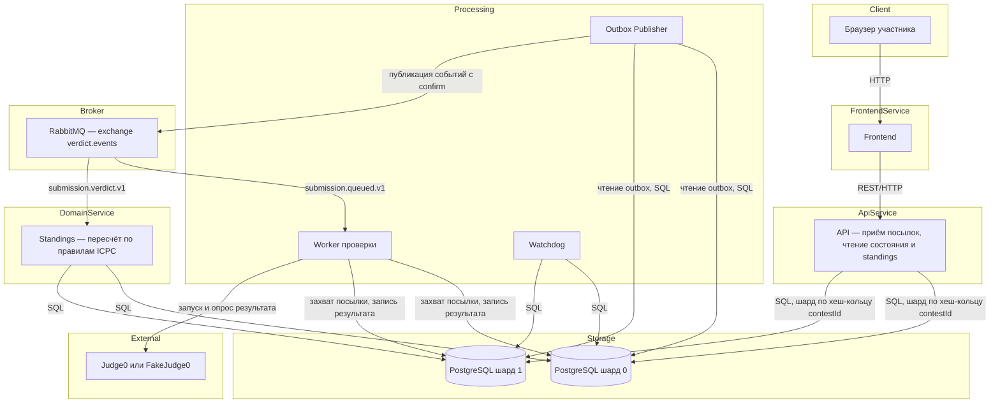

### Состояния посылки

[#состояния-посылки](#состояния-посылки)

Посылка проходит через фиксированный набор статусов; допустимые переходы заданы в коде и проверяются тестами. `submitted_at` — неизменяемое время принятия отправки API и используется для расчёта ICPC; `created_at` — время создания записи в БД, `updated_at` — время последнего изменения записи. Вердикт заполнен тогда и только тогда, когда статус равен `COMPLETED` (это ограничение дополнительно закреплено в базе данных через `CHECK`).

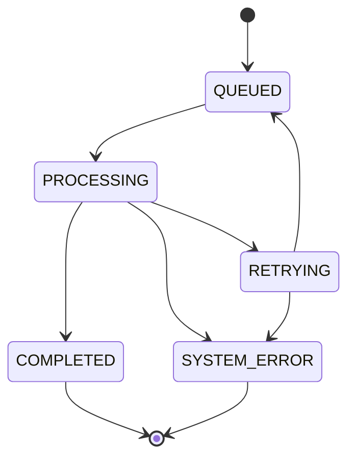

### Модель данных

[#модель-данных](#модель-данных)

Все таблицы одного контеста находятся на одном шарде, поэтому внешние ключи и транзакции остаются локальными. Идентификаторы — UUID, время — `TIMESTAMPTZ` в UTC; в API и событиях поля называются в `camelCase`, в базе — в `snake_case`.

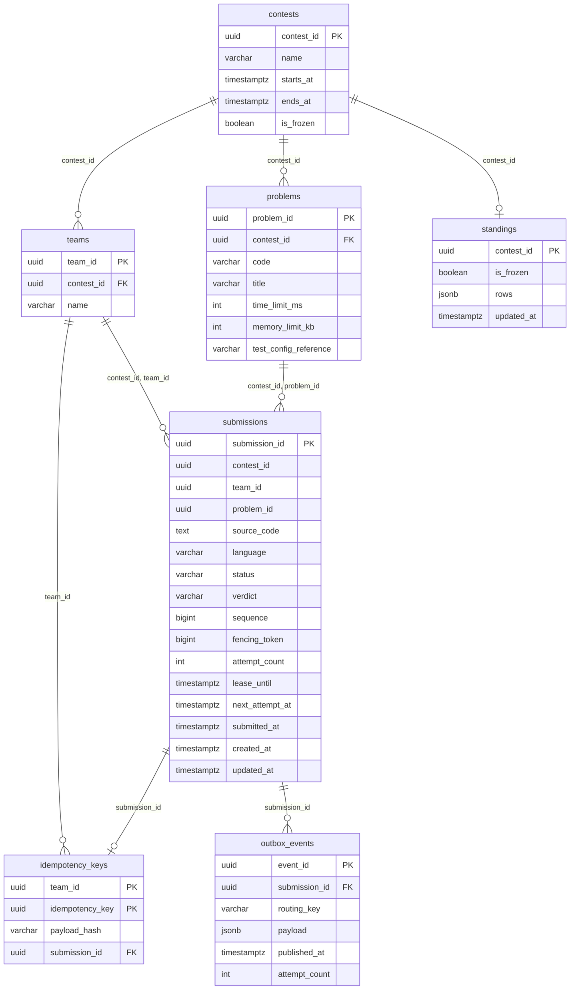

### Распределение данных по шардам

[#распределение-данных-по-шардам](#распределение-данных-по-шардам)

- **Проблема:** данные и нагрузка одного узла ограничены; при этом отправка посылки должна атомарно менять несколько таблиц.
- **Решение:** данные распределяются между двумя узлами PostgreSQL (`postgres_shard_0`, `postgres_shard_1`) методом consistent hashing с виртуальными узлами (128 на каждый физический узел). Ключ распределения — `contestId`; позиция вычисляется по SHA-256, поэтому результат одинаков на любой машине. Посылка, ключ идемпотентности и событие outbox всегда лежат на шарде своего контеста. Для доступа по одному `submissionId` (чтение посылки, захват worker'ом) шард определяется последовательным опросом двух шардов.
- **Гарантия:** одна транзакция «посылка + ключ идемпотентности + событие» всегда локальна для одного шарда, распределённые транзакции не нужны; соответствие `contestId` → шард детерминировано и одинаково на любой машине. Гарантия действует для фиксированной конфигурации из двух шардов: в прототипе состав шардов и параметры кольца (число виртуальных узлов) не меняются, добавление и удаление узлов и перенос данных не реализуются. Свойство consistent hashing «при добавлении узла перемещается лишь часть ключей» приводится как причина выбора метода, но в прототипе не гарантируется и не демонстрируется.
- **Компромиссы:** один очень большой контест не распределяется между узлами (горячий шард); обращение по `submissionId` требует опроса обоих шардов (для двух шардов накладные расходы небольшие); репликация, автоматическое переключение при отказе узла и перенос контестов между шардами при изменении кольца в прототип не входят.

### Доставка событий и идемпотентность

[#доставка-событий-и-идемпотентность](#доставка-событий-и-идемпотентность)

- **Проблема:** если сервис сохранил посылку и упал до отправки сообщения, о посылке никто не узнает; если отправил сообщение до сохранения и упал, сообщение укажет на несуществующую посылку. Клиент может повторить запрос после обрыва связи.
- **Решение:** событие записывается в `outbox_events` в той же транзакции, что и изменение данных; отдельный Outbox Publisher отправляет его в брокер с подтверждением и только после этого помечает опубликованным. Публикация в RabbitMQ напрямую из API или worker'а запрещена. Запрос отправки идемпотентен по паре (`teamId`, `Idempotency-Key`): ключ занимается атомарно (`INSERT ... ON CONFLICT DO NOTHING`), хеш тела запроса (SHA-256) сравнивается с сохранённым. Поиск ключа выполняется раньше проверки окна контеста и существования сущностей, поэтому повтор после `endsAt` возвращает исходную посылку.
- **Гарантия:** запись outbox не теряется при отказе брокера или publisher'а и может быть опубликована после восстановления зависимостей; это не означает мгновенную доставку при недоступном брокере. Повторный запрос с тем же ключом и телом возвращает ту же посылку, с другим телом — ошибку `409 IDEMPOTENCY_KEY_REUSED`.
- **Компромиссы:** выбрана семантика at-least-once вместо at-most-once: потеря события хуже дубликата; дубли возможны (publisher мог опубликовать событие и упасть до отметки), поэтому потребители должны быть устойчивы к повторам. `sequence` — монотонный номер логического события в рамках одной посылки: он увеличивается при создании нового логического события, но не при повторной публикации того же события; дубликат сохраняет исходные `eventId` и `sequence`. Порядок публикации не гарантирует порядок коммитов, поэтому потребители должны учитывать `sequence`.

### Обработка отказов worker'а и Judge0

[#обработка-отказов-worker-а-и-judge0](#обработка-отказов-worker-а-и-judge0)

- **Проблема:** worker может упасть или «зависнуть» во время проверки, Judge0 может быть временно недоступен; «опоздавший» worker не должен перезаписать результат другого.
- **Решение:** worker атомарно захватывает посылку в базе данных: статус `PROCESSING`, увеличение `fencing_token`, установка `lease_until`; во время проверки аренда продлевается (heartbeat раз в треть срока аренды). Захват возможен только из статуса `QUEUED`. Результат записывается одним условным `UPDATE` только при совпадении `fencing_token`, статусе `PROCESSING` и ещё действующей аренде (`lease_until > now()`); в той же транзакции добавляется событие вердикта в outbox. Те же условия требуются для **любого** перехода, который выполняет worker: `COMPLETED`, `RETRYING` и `SYSTEM_ERROR`. Если условный `UPDATE` не затронул ни одной строки, worker потерял владение посылкой: он ничего не меняет, не создаёт событий и прекращает обработку (`stale_token`). Посылка в статусе `RETRYING` не может быть захвачена сообщением из очереди раньше `next_attempt_at`: её сначала возвращает в `QUEUED` Watchdog (условный `UPDATE` при статусе `RETRYING` и `next_attempt_at <= now()`). Недоступность или таймаут Judge0 переводят посылку в `RETRYING` с задержкой, растущей экспоненциально (с jitter); после `MAX_RETRY_ATTEMPTS` попыток посылка получает `SYSTEM_ERROR`. Watchdog атомарно переводит посылку с истёкшей арендой в `RETRYING`, а при наступлении `next_attempt_at` возвращает её в `QUEUED` и создаёт событие повторной постановки в outbox в той же транзакции. Повторная публикация события допустима.
- **Гарантия:** каждая принятая посылка приходит в финальный статус (`COMPLETED` или `SYSTEM_ERROR`) при условии, что хранилище и брокер со временем восстанавливаются; результат одной посылки записывается не более одного раза. Исключение — посылки, события которых попали в `submission.dlq`: они остаются в `QUEUED` до ручного разбора.
- **Компромиссы:** слишком короткая аренда приводит к ложным повторам, слишком длинная — к долгой реакции на отказ; ошибки инфраструктуры (`SYSTEM_ERROR`) не дают вердикта и не влияют на standings.

### Расчёт standings и freeze

[#расчёт-standings-и-freeze](#расчёт-standings-и-freeze)

- **Проблема:** результаты должны считаться по правилам ICPC, повторная доставка события не должна менять таблицу дважды, а в режиме freeze публичная таблица не должна изменяться.
- **Решение:** событие `submission.verdict.v1` служит сигналом для пересчёта строки команды по посылкам контеста с вердиктом, в порядке отправки. Пересчёт идемпотентен: повторная или переставленная доставка события не меняет результат. Чтобы два параллельных пересчёта одного контеста не перезаписали друг друга устаревшим результатом, пересчёт выполняется **под блокировкой контеста**: в одной транзакции на шарде контеста Standings берёт блокировку строки `standings` этого контеста (`SELECT ... FOR UPDATE`; строка создаётся вместе с демо-данными контеста), затем читает флаг `is_frozen` и посылки с вердиктами, считает строки и записывает их. Пересчёты одного контеста выполняются строго последовательно, и каждый следующий читает данные уже после коммита предыдущего, поэтому более ранний результат не заменит более свежий; пересчёты разных контестов друг друга не блокируют. Включение и снятие freeze выполняются под той же блокировкой. Правила:
  - выше команда с большим числом решённых задач; при равенстве — с меньшим штрафом;
  - задача решена по первому вердикту `ACCEPTED`; штраф за задачу — минуты от начала контеста до успешной посылки плюс 20 минут за каждую неверную попытку до неё;
  - штрафуются `WRONG_ANSWER`, `TIME_LIMIT_EXCEEDED`, `RUNTIME_ERROR`; не штрафуются `COMPILATION_ERROR` и `SYSTEM_ERROR`; попытки после первого `ACCEPTED` игнорируются.
  
  Пример на демо-данных: команда Alpha — задача A принята на 12-й минуте, итог: решено 1, штраф 12; команда Beta — задача A: `WRONG_ANSWER` на 20-й минуте, `ACCEPTED` на 45-й, итог: решено 1, штраф 45 + 20 = 65. В режиме freeze (флаг `is_frozen` контеста) публичная строка standings не обновляется, проверка посылок продолжается; собственные вердикты участника доступны через запрос посылки. После снятия freeze строки пересчитываются по накопленным данным в той же транзакции, которая снимает флаг.
- **Гарантия:** повторная проверка или повторная доставка события не приводит к повторному учёту результата; после снятия freeze таблица отражает все завершённые проверки.
- **Компромиссы:** пересчёт строки обращается к данным посылок, а не только к содержимому события; таблица может временно отставать от вердиктов (eventual consistency).

### Формат событий

[#формат-событий](#формат-событий)

События передаются через durable exchange `verdict.events`; ключи маршрутизации и очереди: `submission.queued.v1` → durable-очередь `submission.queued`, `submission.verdict.v1` → durable-очередь `submission.verdict`; в `submission.dlq` направляются сообщения, которые невозможно обработать, и сообщения, число доставок которых превысило `MAX_DELIVERY_ATTEMPTS` (подробности — в сценарии проверки посылки worker'ом); при временной ошибке инфраструктуры сообщение возвращается в очередь, а не подтверждается. Публикуемые сообщения persistent. Publisher использует publisher confirms и помечает событие outbox опубликованным только после подтверждения брокера. Consumer подтверждает (`ACK`) сообщение только после безопасного завершения обработки и фиксации изменений в БД. Если consumer упал до `ACK`, сообщение может быть доставлено повторно. Тело — JSON в `camelCase`, версия схемы `schemaVersion = 1`.

| Событие                 | Основные поля                                                                                                                           |
| ----------------------- | --------------------------------------------------------------------------------------------------------------------------------------- |
| `submission.queued.v1`  | `eventId`, `schemaVersion`, `traceId`, `occurredAt`, `submissionId`, `sequence`                                                         |
| `submission.verdict.v1` | те же поля, а также `fencingToken`, `status` (`COMPLETED`), `verdict`, `submittedAt`, `contestId`, `teamId`, `problemId`                |

`attemptId` не входит в начальное событие постановки в очередь: попытка обработки появляется только после захвата посылки worker'ом. Поля `submittedAt`, `contestId`, `teamId` и `problemId` в вердикт-событии нужны для расчёта штрафа ICPC и пересчёта строки команды; контракт событий фиксирует их наличие.

### Известные ограничения прототипа

[#известные-ограничения-прототипа](#известные-ограничения-прототипа)

- Нет репликации PostgreSQL и автоматического failover узла базы данных.
- Перенос контестов между шардами при изменении хеш-кольца не реализуется.
- Поддерживается только язык C++, один набор статусов и вердикты, перечисленные в глоссарии.
- Очистка опубликованных событий outbox не реализуется.
- Аутентификация и авторизация пользователей не реализуются; команда передаётся в запросе.
- Организатор готовит контесты, команды и задачи заранее (подготовленные данные); полноценный интерфейс управления контестами не входит в основной контур.
- Проверка в основном контуре выполняется имитацией `FakeJudge0` (вердикт по маркеру в коде, тесты задач не запускаются); корректность проверки произвольных решений не демонстрируется.
- Сообщения из `submission.dlq` разбираются вручную; связанная посылка остаётся в статусе `QUEUED` до повторной публикации события.
- Состав шардов фиксирован (два шарда); consistent hashing используется для детерминированного выбора шарда по `contestId`.

---

## Технические сценарии

[#технические-сценарии](#технические-сценарии)

### Сценарий: отправка решения

[#сценарий-отправка-решения-1](#сценарий-отправка-решения-1)

1. Клиент отправляет в API запрос `POST /api/v1/submissions` с заголовком `Idempotency-Key` (UUID) и телом: `contestId`, `teamId`, `problemId`, `language` (`cpp`), `sourceCode`.
2. API проверяет тело запроса и заголовок; при ошибке возвращает `400 VALIDATION_ERROR`.
3. API вычисляет SHA-256 от канонического представления тела и вызывает репозиторий.
4. Репозиторий на шарде контеста **в первую очередь** ищет ключ идемпотентности (`teamId`, `Idempotency-Key`) — до проверки окна контеста и существования контеста, команды и задачи. Если ключ найден, выполняется сценарий «повторный запрос» (ниже): совпал хеш тела — `202` с исходным `submissionId`, не совпал — `409 IDEMPOTENCY_KEY_REUSED`. Поэтому повтор запроса после `endsAt` возвращает исходную посылку, а не `CONTEST_NOT_OPEN`.
5. Если ключ не найден, репозиторий проверяет существование контеста, команды и задачи и то, что контест открыт для отправок; при ошибке возвращается `404` (`CONTEST_NOT_FOUND`, `TEAM_NOT_FOUND`, `PROBLEM_NOT_FOUND`) или `409 CONTEST_NOT_OPEN`; ключ при этом не сохраняется.
6. В одной транзакции репозиторий занимает ключ (`INSERT ... ON CONFLICT DO NOTHING`), создаёт посылку со статусом `QUEUED` (`sequence = 1`) и записывает событие `submission.queued.v1` в outbox. Если при гонке двух одинаковых запросов ключ уже занят другим запросом, транзакция продолжает по шагу 4.
7. При недоступности базы данных API возвращает `503 TEMPORARILY_UNAVAILABLE`; клиент может повторить запрос с тем же ключом.
8. API возвращает `202 Accepted` с `submissionId`, `status` и `createdAt`.
9. Асинхронно: Outbox Publisher публикует событие в RabbitMQ и после подтверждения помечает его опубликованным.

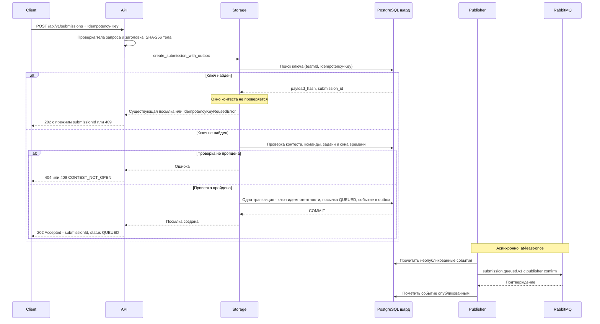

### Сценарий: повторный запрос с тем же Idempotency-Key

[#сценарий-повторный-запрос-с-тем-же-idempotency-key](#сценарий-повторный-запрос-с-тем-же-idempotency-key)

1. Клиент после обрыва связи повторяет запрос отправки с тем же `Idempotency-Key`.
2. Репозиторий в первую очередь ищет ключ — до проверки окна контеста и существования контеста, команды и задачи; ключ найден, в базу ничего не записывается. Повтор допустим и после `endsAt`: клиент получает исходный результат.
3. Репозиторий сравнивает хеш тела запроса с сохранённым.
4. Если хеш совпал — API возвращает `202` с тем же `submissionId` (текущий статус посылки может быть уже другим).
5. Если хеш отличается — API возвращает `409 IDEMPOTENCY_KEY_REUSED`.

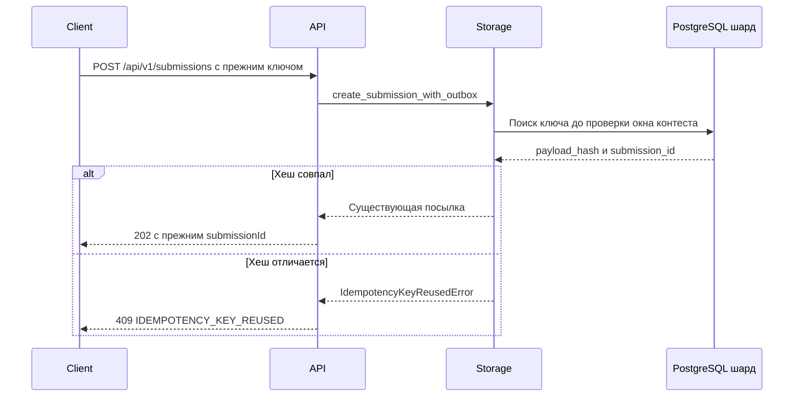

### Сценарий: проверка посылки worker'ом

[#сценарий-проверка-посылки-worker-ом](#сценарий-проверка-посылки-worker-ом)

1. Worker получает из очереди `submission.queued` событие о новой посылке.
2. Worker атомарно захватывает посылку: условный `UPDATE` возможен только из статуса `QUEUED` — статус `PROCESSING`, `fencing_token` увеличивается, устанавливается `lease_until`. Возможные исходы:
   - захват выполнен — проверка продолжается;
   - посылка по состоянию не может быть захвачена (финальный статус, уже захвачена другим worker'ом с действующей арендой, статус `RETRYING` до наступления `next_attempt_at`) — сообщение подтверждается без обработки; дальнейшее движение посылки обеспечивает её владелец или Watchdog (восстановление после истечения аренды, возврат `RETRYING` → `QUEUED` с новым событием);
   - временная ошибка инфраструктуры при захвате (база недоступна, таймаут) — сообщение **не** подтверждается: `NACK` с возвратом в очередь и повторная доставка с задержкой; посылка остаётся `QUEUED`. Подтверждение здесь привело бы к потере сигнала на обработку, так как Watchdog посылки в статусе `QUEUED` не восстанавливает;
   - сообщение невозможно обработать (тело не разбирается, неподдерживаемая `schemaVersion`, посылка с таким `submissionId` не найдена ни на одном шарде) либо число доставок превысило `MAX_DELIVERY_ATTEMPTS` — `NACK` без возврата в очередь, сообщение попадает в `submission.dlq`. Посылка при этом не изменяется: если она существует, то остаётся в статусе `QUEUED` и требует ручного разбора очереди `submission.dlq` и повторной публикации события (известное ограничение прототипа).
3. Worker загружает исходный код, язык, лимиты задачи (`time_limit_ms`, `memory_limit_kb`) и ссылку на тестовые данные (`test_config_reference`).
4. Worker отправляет в Judge0 код, язык и лимиты и опрашивает результат, пока он не будет готов; во время проверки периодически продлевает аренду.
5. Worker сопоставляет результат Judge0 с вердиктом контракта (см. ниже, как используются тесты задачи).
6. Worker записывает результат одним условным `UPDATE` (совпадение `fencing_token`, статус `PROCESSING` и `lease_until > now()`) и в той же транзакции добавляет в outbox событие `submission.verdict.v1`; посылка получает статус `COMPLETED`.
7. Worker подтверждает сообщение брокеру.

**Как используются тесты задачи.** В полном потоке `test_config_reference` указывает на набор тестов задачи (входные данные и ожидаемый вывод). Judge0 компилирует код, запускает его на каждом тесте с ограничениями `time_limit_ms` и `memory_limit_kb` и сравнивает вывод с ожидаемым; итоговый вердикт агрегируется по тестам: ошибка компиляции — `COMPILATION_ERROR`; первый непройденный тест определяет `WRONG_ANSWER`, `TIME_LIMIT_EXCEEDED` или `RUNTIME_ERROR`; если пройдены все тесты — `ACCEPTED`.

**Граница прототипа.** В основном контуре проверку выполняет имитация `FakeJudge0`: она не запускает код, не использует тестовые данные и выбирает вердикт по маркеру `// @judge: <вердикт>` в исходном коде. Поэтому прототип демонстрирует распределённый конвейер (идемпотентность, очередь, outbox, fencing token, повторные попытки, шарды, standings), а не корректность проверки произвольных решений. Подключение self-hosted Judge0 с реальными тестами задач в основной контур не входит.

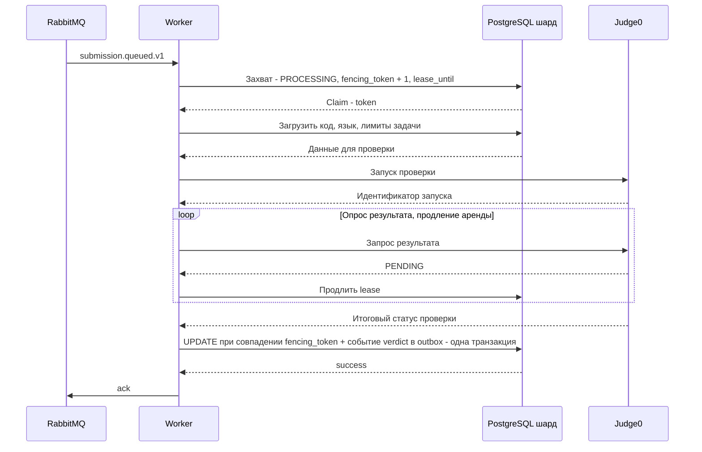

### Сценарий: получение статуса и вердикта посылки

[#сценарий-получение-статуса-и-вердикта-посылки](#сценарий-получение-статуса-и-вердикта-посылки)

1. Клиент отправляет в API запрос `GET /api/v1/submissions/{submissionId}`.
2. API проверяет формат `submissionId`; при ошибке возвращает `400`.
3. Репозиторий ищет посылку на шарде 0, затем на шарде 1.
4. Если посылка не найдена — `404 SUBMISSION_NOT_FOUND`.
5. API возвращает `status`, `verdict` (`null`, пока статус не `COMPLETED`, а также при `SYSTEM_ERROR`), `createdAt`, `updatedAt` и `sequence`.

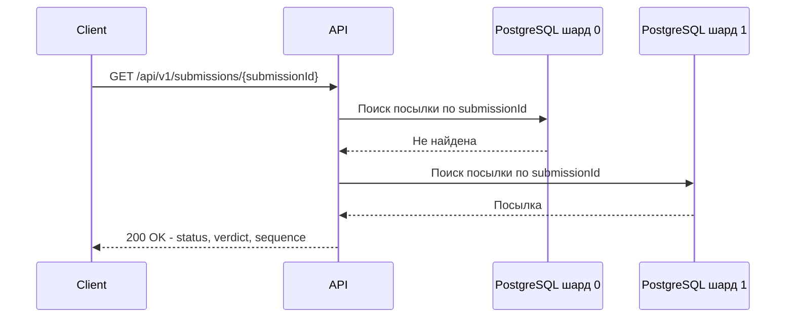

### Сценарий: отказ worker'а во время проверки

[#сценарий-отказ-worker-а-во-время-проверки](#сценарий-отказ-worker-а-во-время-проверки)

1. Worker 1 захватил посылку (`fencing_token = 1`) и перестал отвечать; аренда не продлевается.
2. Watchdog атомарно переводит посылку с истёкшей арендой в `RETRYING`, а затем через `QUEUED` возвращает её в очередь; изменение состояния и запись события повторной постановки в outbox выполняются в одной транзакции.
3. Worker 2 захватывает посылку (`fencing_token = 2`) и завершает проверку.
4. Если Worker 1 «оживает» и пытается записать результат с токеном 1, условный `UPDATE` не находит строку, результат отбрасывается (`stale_token`).
5. Посылка получает ровно один результат.

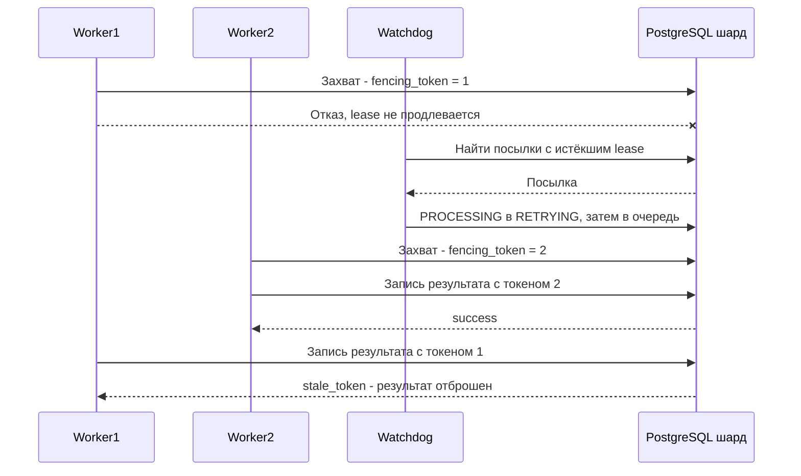

### Сценарий: недоступность Judge0

[#сценарий-недоступность-judge0](#сценарий-недоступность-judge0)

1. Worker захватил посылку, но Judge0 недоступен или не ответил за отведённое время.
2. Если число попыток не исчерпано, worker одним условным `UPDATE` (совпадение `fencing_token`, статус `PROCESSING`, `lease_until > now()`) переводит посылку в `RETRYING` и сохраняет время следующей попытки: задержка растёт экспоненциально от `RETRY_BASE_DELAY_SECONDS` с ограничением сверху и случайным разбросом.
3. Пока `next_attempt_at` не наступило, посылка в статусе `RETRYING` не захватывается, даже если в очереди оказалось сообщение о ней. Watchdog по наступлении `next_attempt_at` атомарно переводит посылку из `RETRYING` в `QUEUED` и создаёт событие повторной постановки в outbox в той же транзакции; после публикации проверка повторяется.
4. Если число попыток достигло `MAX_RETRY_ATTEMPTS`, worker тем же условным `UPDATE` (с проверкой `fencing_token`, статуса и аренды) переводит посылку в финальный статус `SYSTEM_ERROR` без вердикта; если условие не выполнено, worker потерял владение посылкой и ничего не меняет; событие вердикта не создаётся, standings не затрагиваются, штрафное время не начисляется.

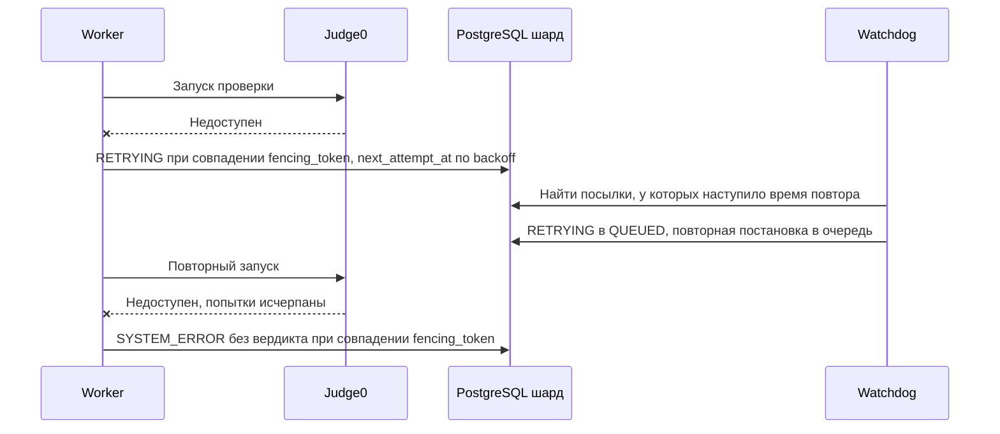

### Сценарий: потеря и повторная доставка события

[#сценарий-потеря-и-повторная-доставка-события](#сценарий-потеря-и-повторная-доставка-события)

1. Событие записано в outbox, но брокер временно недоступен или не подтвердил публикацию.
2. Publisher сохраняет ошибку и увеличивает счётчик неудачных попыток; событие остаётся неопубликованным.
3. Publisher повторяет отправку, пока не получит подтверждение, и только затем помечает событие опубликованным.
4. Если publisher упал после публикации, но до отметки, событие будет отправлено повторно — потребитель получит дубль.
5. Потребитель обрабатывает событие идемпотентно (для standings — пересчётом строки команды), поэтому дубль не меняет результат.

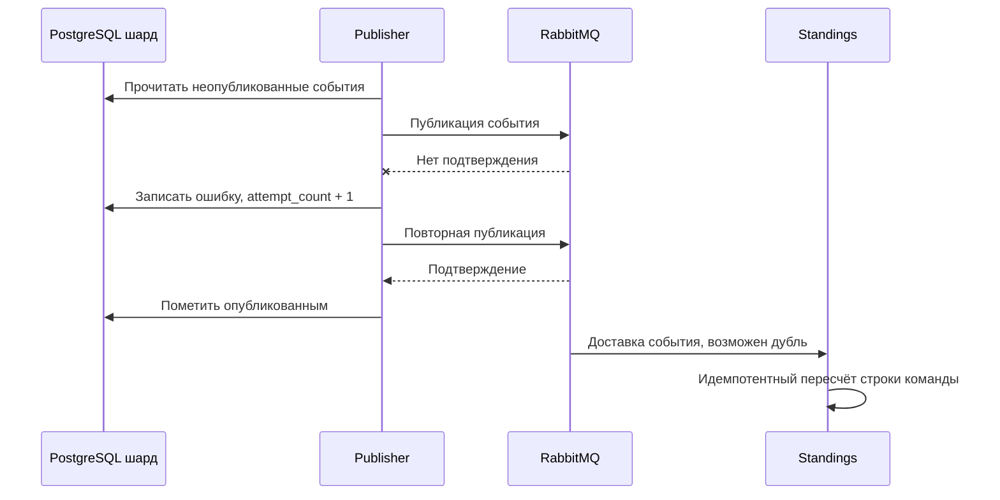

### Сценарий: просмотр standings

[#сценарий-просмотр-standings](#сценарий-просмотр-standings)

1. После записи вердикта событие `submission.verdict.v1` попадает в очередь `submission.verdict` и доставляется компоненту Standings.
2. Standings определяет контест и команду по событию и под блокировкой строки `standings` контеста пересчитывает строку команды по правилам ICPC.
3. Если контест не в режиме freeze, обновлённые строки сохраняются в таблице `standings`; если в режиме freeze — публичные строки не меняются.
4. Участник запрашивает `GET /api/v1/contests/{contestId}/standings`.
5. API возвращает строки, отсортированные по числу решённых задач и штрафу, и признак `frozen`.

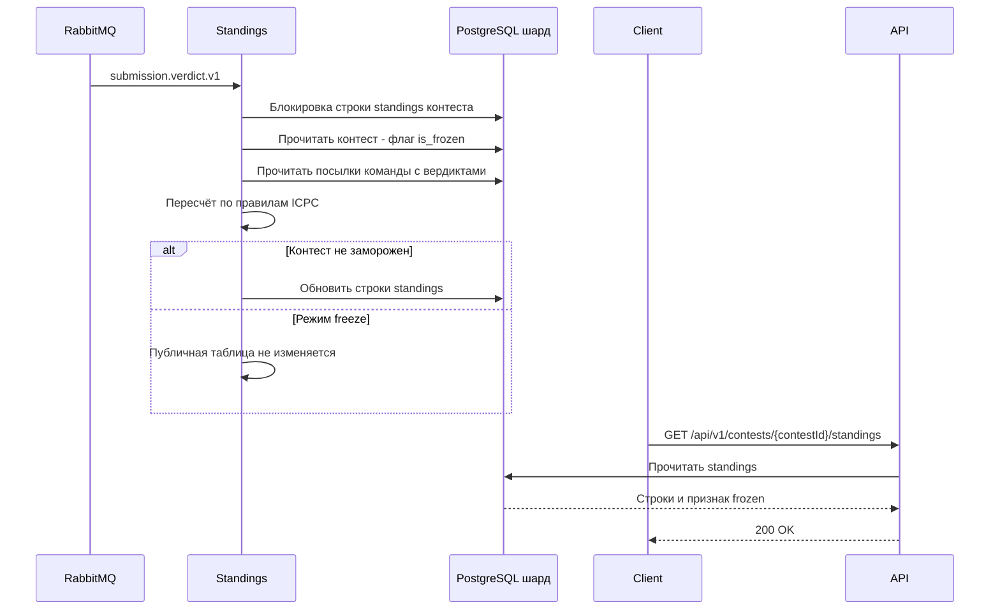

### Сценарий: включение и снятие freeze

[#сценарий-включение-и-снятие-freeze](#сценарий-включение-и-снятие-freeze)

1. Организатор отправляет `POST /api/v1/contests/{contestId}/freeze`; под блокировкой строки `standings` контеста устанавливается флаг `is_frozen`.
2. Пока флаг установлен, проверка посылок и запись вердиктов продолжаются, публичная таблица не меняется, участник видит свои вердикты через запрос посылки.
3. Организатор отправляет `POST /api/v1/contests/{contestId}/unfreeze`; Standings под той же блокировкой снимает флаг и в той же транзакции пересчитывает строки по накопленным данным. События вердиктов, пришедшие в это время, ждут блокировки и обрабатываются после коммита.
4. Публичная таблица отражает все завершённые проверки.

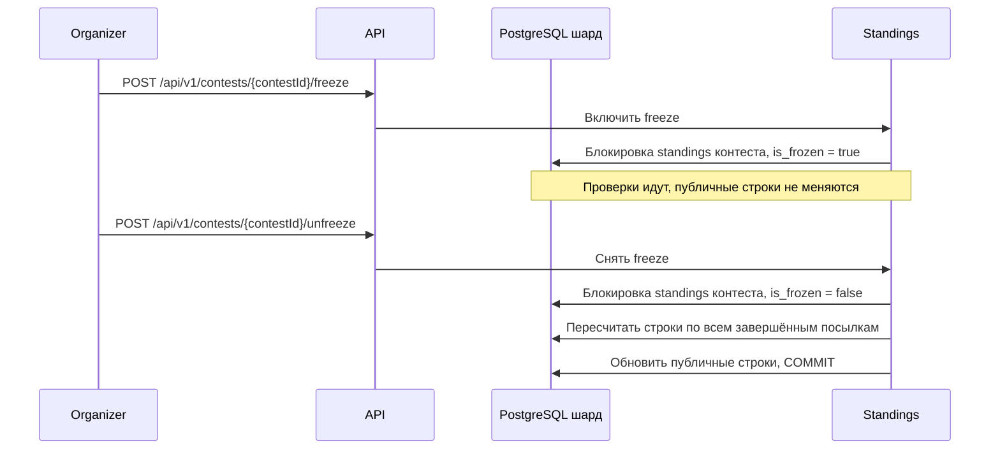

---

## План разработки и тестирования

[#план-разработки-и-тестирования](#план-разработки-и-тестирования)

**Включает (основной контур):**

- Приём посылки через API с проверкой запроса, окна контеста, существования команды и задачи и идемпотентностью по `Idempotency-Key`
- Атомарное сохранение посылки, ключа идемпотентности и события в outbox на шарде контеста
- Хранилище: два шарда PostgreSQL, миграции, демо-данные, маршрутизация по хеш-кольцу
- Outbox Publisher и обмен событиями через RabbitMQ (at-least-once)
- Worker: захват посылки, проверка через адаптер Judge0 (в демонстрации — `FakeJudge0`), запись результата с проверкой fencing token
- Обработка отказов worker'а и Judge0: аренда, повторные попытки с задержкой, статус `SYSTEM_ERROR`
- Чтение статуса и вердикта посылки
- Пересчёт standings по правилам ICPC на демо-данных под блокировкой контеста (последовательные пересчёты одного контеста)
- Режим freeze: включение, снятие, пересчёт после снятия
- Чтение контестов, списка задач и состояния контеста: эндпоинты чтения и демо-данные (создание контестов, добавление задач и регистрация команд выполняются подготовленными данными)
- Веб-интерфейс участника: список контестов и задач, отправка решения, статус посылки, standings с признаком freeze

**Если останется время:**

- Подключение self-hosted Judge0 с реальными тестами задач вместо имитации
- SSE-поток обновлений посылок контеста (описан в контракте API)

**Не входит в прототип:**

- Репликация PostgreSQL и автоматическое переключение при отказе узла базы данных
- Перенос контестов между шардами при изменении хеш-кольца
- Аутентификация и авторизация, управление организаторами
- Языки, кроме C++

**План разработки:**

1. Согласование контракта API (`openapi.yaml`) и формата событий (`submission.queued.v1`, `submission.verdict.v1`, включая `submittedAt`, `contestId`, `teamId`, `problemId` в вердикт-событии)
2. Согласование правил: окно контеста, ICPC scoring, режим freeze
3. Схема данных, миграции и демо-данные; хеш-кольцо и выбор шарда по `contestId`
4. Репозиторий отправок и outbox: атомарное создание, идемпотентность, публикация событий
5. Операции worker'а в репозитории: захват, продление аренды, запись результата с fencing token, повторные попытки, восстановление по истечении аренды
6. Приложение API: роутеры, обработка ошибок, подключение репозитория и проверки контеста, команды и задачи; эндпоинты чтения контестов, задач и standings и эндпоинты freeze/unfreeze (с обновлением `openapi.yaml`); Dockerfile и зависимости сервиса
7. Outbox Publisher и работа с RabbitMQ (exchange, очереди, dead-letter)
8. Worker и Watchdog; адаптер Judge0 и `FakeJudge0`
9. Standings: пересчёт по правилам ICPC под блокировкой контеста, хранение в `standings`, freeze и unfreeze
10. Frontend: список контестов и задач, форма отправки, статус посылки, standings с признаком freeze; клиент, соответствующий контракту API
11. Документирование запуска сервисов и описание API

**План тестирования:**

- Модульные тесты: статусы и переходы, контракты и схемы, идемпотентность и хеш тела запроса, политика повторов, адаптер Judge0, хеш-кольцо, сборка событий
- Тесты API с заглушкой репозитория: коды ответов `503`, `409 IDEMPOTENCY_KEY_REUSED`, `404 TEAM_NOT_FOUND`, `404 PROBLEM_NOT_FOUND`, `409 CONTEST_NOT_OPEN`, успешный `202`
- Интеграционные тесты репозитория на PostgreSQL: атомарность «посылка + ключ + событие», идемпотентный повтор, конфликт ключа, чтение посылки по `submissionId` на любом шарде
- Тесты согласованности форматов: события, собираемые хранилищем, разбираются моделями контракта, поле `submittedAt` не теряется
- Контрактный тест клиента frontend против примеров из `openapi.yaml` (идентификаторы — UUID)
- Тест идемпотентности: повторный запрос с тем же ключом не создаёт вторую посылку
- Тест отказа worker'а: после истечения аренды посылка получает результат ровно один раз, запись с устаревшим токеном отбрасывается
- Тест недоступности Judge0: повторные попытки и финальный статус `SYSTEM_ERROR` без влияния на standings
- Тест standings на демо-данных: ожидаемый результат команд Alpha и Beta; повторная доставка вердикта не меняет таблицу
- Тест freeze: во время freeze публичная таблица не меняется, после снятия отражает все проверки
- Тест конкурентного пересчёта: два параллельных пересчёта одного контеста не дают устаревшей строки (последовательность под блокировкой)
- Тест порядка проверок при отправке: повтор запроса с тем же ключом после `endsAt` возвращает исходную посылку, новый ключ после `endsAt` — `409 CONTEST_NOT_OPEN`
- Тесты worker'а: записи `RETRYING` и `SYSTEM_ERROR` со старым `fencing_token` отбрасываются; посылка в `RETRYING` не захватывается раньше `next_attempt_at`; временная ошибка захвата не подтверждает сообщение; неразбираемое сообщение попадает в `submission.dlq`
- Тесты UI (mock-режим): страницы формы, статуса и standings, баннеры ошибок (`503`, `409`, `404`), автообновление статуса до финального, состояния «таблица пуста» и freeze
- Проверка граничных случаев (пустой или слишком большой исходный код, неподдерживаемый язык, контест вне окна проведения)
- Запуск тестов с отчётом о пропущенных (`pytest -rs`); пути к сервисам заданы в `pytest.ini`, поэтому пропуск тестов не считается успехом; CI (`.github/workflows/ci.yml`) выполняет `ruff check`, `ruff format --check` и `pytest`

**Definition of Done (DoD):**

- Развёрнуты два шарда PostgreSQL, применены миграции, загружены демо-данные
- Отправка решения через API возвращает `202`, посылка проходит `QUEUED` → `PROCESSING` → `COMPLETED` и получает вердикт (проверка может выполняться через `FakeJudge0`)
- Повторный запрос с тем же `Idempotency-Key` и телом не создаёт вторую посылку; тот же ключ с другим телом возвращает `409`
- Скрипт проверки атомарности подтверждает, что при ошибке записи события откатывается вся транзакция
- После остановки worker'а во время проверки посылка получает результат ровно один раз
- При недоступности Judge0 после исчерпания попыток посылка получает `SYSTEM_ERROR`
- Standings по демо-данным соответствует ожидаемому результату (Alpha: решено 1, штраф 12; Beta: решено 1, штраф 65) и не меняется при повторной доставке события
- Freeze: пока режим включён, публичная таблица не меняется, а проверки продолжаются; после снятия таблица отражает все завершённые проверки
- Повтор запроса отправки с тем же `Idempotency-Key` после окончания контеста возвращает исходную посылку
