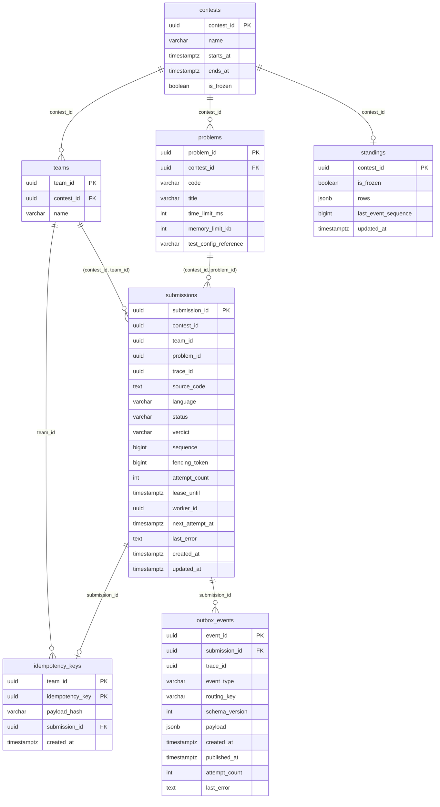

# VERDICT — модель данных (хранилище)

Версия 1.0 · владелец: №1 (Backend/Data) · миграция: `services/storage/migrations/versions/0001_initial_schema.py`

## 1. Общие правила

- Идентификаторы везде `UUID`.
- Время: `TIMESTAMPTZ`, значения в UTC; в API и событиях ISO 8601 с `Z`.
- Таблицы и колонки: `snake_case`, таблицы во множественном числе. В JSON те же поля отдаются в `camelCase`.
- Суффиксы единиц `_ms` (миллисекунды) и `_kb` (килобайты) допустимы в колонках. Этого пункта пока нет в разделе 9 соглашения об именах, его нужно добавить PR'ом.
- Статусы и вердикты хранятся как `VARCHAR` с `CHECK`, а не как PostgreSQL ENUM: добавить значение в CHECK проще, чем изменить тип.
- Все данные одного соревнования лежат на одном шарде, поэтому внешние ключи между таблицами работают без ограничений.

## 2. ER-диаграмма

## 3. Где что хранится

| Сущность | Таблица | Владелец логики | Примечание |
|---|---|---|---|
| Соревнование | `contests` | №3 | `is_frozen` — флаг заморозки рейтинга |
| Команда | `teams` | №3 | принадлежит ровно одному соревнованию |
| Задача | `problems` | №3 | лимиты и `test_config_reference` читает worker №2 для Judge0 |
| Отправка и её состояние | `submissions` | №1 / №2 | статус, вердикт, `sequence`, lease и `fencing_token` |
| Защита от дублей POST | `idempotency_keys` | №1 / №2 | ключ `(team_id, idempotency_key)` |
| События для RabbitMQ | `outbox_events` | №1 / №2 | см. `outbox.md` |
| Кэш рейтинга | `standings` | №3 | запрошена в domain-model-v3 |

Отдельной таблицы `SubmissionAttempt/Lease` нет: lease и счётчик попыток помещаются в колонки `submissions` (`lease_until`, `worker_id`, `attempt_count`, `fencing_token`). История попыток сценариями курса не требуется.

## 4. Ограничения

| Таблица | Ограничение | Зачем |
|---|---|---|
| `contests` | `ends_at > starts_at` | корректный интервал |
| `teams` | `UNIQUE (contest_id, team_id)` | цель составного FK из `submissions` |
| `problems` | `UNIQUE (contest_id, code)` | код задачи уникален внутри соревнования |
| `problems` | `UNIQUE (contest_id, problem_id)`, `time_limit_ms > 0`, `memory_limit_kb > 0` | составной FK и разумные лимиты |
| `submissions` | `FOREIGN KEY (contest_id, team_id) → teams` | команда обязана быть из того же соревнования |
| `submissions` | `FOREIGN KEY (contest_id, problem_id) → problems` | задача обязана быть из того же соревнования |
| `submissions` | `octet_length(source_code) BETWEEN 1 AND 65536` | лимит из контракта, в байтах UTF-8 |
| `submissions` | `language IN ('CPP')` | только C++ |
| `submissions` | `status IN (QUEUED, PROCESSING, RETRYING, COMPLETED, SYSTEM_ERROR)` | |
| `submissions` | `verdict IS NULL OR verdict IN (...)` | пять вердиктов контракта |
| `submissions` | `(status = 'COMPLETED') = (verdict IS NOT NULL)` | вердикт есть тогда и только тогда, когда статус COMPLETED |
| `submissions` | `sequence >= 1`, `fencing_token >= 0`, `attempt_count >= 0` | |
| `idempotency_keys` | `PRIMARY KEY (team_id, idempotency_key)` | область ключа из контракта; гонки решает БД |
| `idempotency_keys` | `UNIQUE (submission_id)` | один ключ на отправку |
| `idempotency_keys` | `payload_hash ~ '^[0-9a-f]{64}$'` | SHA-256 в hex |
| `idempotency_keys` | FK на `submissions` — `DEFERRABLE INITIALLY DEFERRED` | см. `outbox.md`, порядок вставок |

Триггер `trg_submissions_set_updated_at` обновляет `updated_at` при любом `UPDATE submissions`.

## 5. Индексы

| Индекс | Для чего |
|---|---|
| `ix_submissions_contest_id_status` | поиск отправок соревнования по статусу (очередь, зависшие) |
| `ix_submissions_contest_id_team_id_problem_id_created_at` | пересчёт standings: попытки команды по задаче в порядке отправки |
| `ix_outbox_events_unpublished_created_at` (частичный, `WHERE published_at IS NULL`) | publisher читает только неопубликованные события, индекс остаётся маленьким |
| `ix_outbox_events_submission_id` | события конкретной отправки |
| уникальные ограничения и PK | создают индексы автоматически |

## 6. Расхождения между документами команды (нужно решить)

| # | Вопрос | Что сделано в схеме |
|---|---|---|
| 1 | Язык: в API `"cpp"` (контракт, п. 5.1), в БД `CPP` (data-model №1 v0) | в БД `CPP`; граница API преобразует `cpp ↔ CPP` |
| 2 | `testConfigRef` (domain-model) против `test_config_reference` (data-model) | `test_config_reference`: соглашение запрещает сокращения |
| 3 | `submittedAt` обязателен в `submission.verdict.v1` (icpc-scoring-v2), в контракте v1.0 его нет | поле добавлено в билдер события; значение берётся из `submissions.created_at`. Контракт нужно обновить PR'ом |
| 4 | `attemptId` есть в событиях, но колонки для него нет (только `attempt_count`) | `attemptId` генерируется при создании события и нигде не хранится. Нужно решить, считать ли его идентификатором попытки |
| 5 | `standings.last_event_sequence` — один счётчик на соревнование, а `sequence` ведётся по каждой отправке отдельно | таблица создана как просил №3, но дедупликация по одному числу не работает; нужна таблица обработанных событий или карта `submissionId → sequence` |
| 6 | В задании день 2 упомянут статус `PENDING` | не используется: в контракте утверждён набор из пяти статусов |
| 7 | `shard = hash(contestId) % 2` (контракт) против consistent hashing с virtual nodes (задание) | см. `storage-adr.md` |
